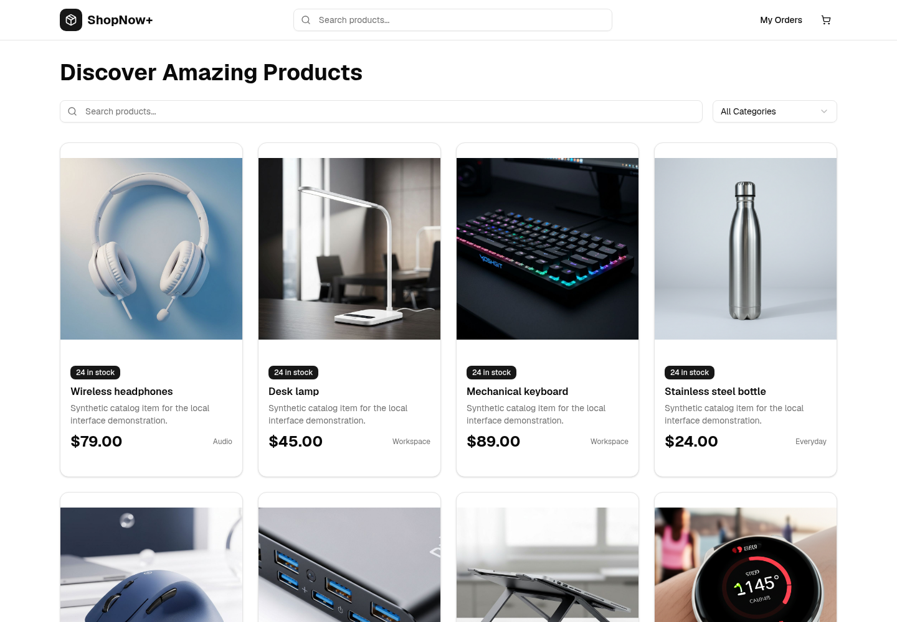
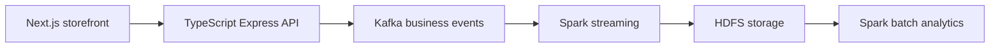

[Français](docs/CASE_STUDY.fr.md) · [Philippe Le Goff](https://github.com/PhilLeGoff) · [Portfolio](https://www.webbyphil.net/)

# ShopNow+

An academic e-commerce system connecting a storefront and business API with event streaming, distributed storage and analytics. It demonstrates how ordinary product actions can feed a data pipeline.

**React · Next.js · TypeScript · Express · Kafka · Spark · HDFS · Docker**

*Screenshot context: real application interface rendered locally with synthetic fixtures. The image does not establish live backend or production usage.*

## What it does

- Product browsing, cart and order workflows in a React/Next.js interface.
- TypeScript API endpoints for product and commerce operations.
- Kafka business events feeding Spark processing and HDFS storage.
- Containerized services and an existing shell-based integration-check suite.

## Architecture

## My contribution

I built this academic project to connect full-stack product workflows with a distributed data pipeline. The useful engineering question is what happens after a user action: which event is emitted, how it is processed, and where the resulting data can be inspected. This is a technical demonstration, not a commercial store.

## Running and inspecting the project

This is a documentation-only repository. The private project uses a Next.js frontend, an Express backend and Docker Compose for Kafka, HDFS and Spark. Its original setup recommends at least 8 GB RAM. The screenshot uses synthetic catalog data, not live orders or pipeline metrics.

## Current state and limitations

Academic demonstration; no real payments, customer adoption or production throughput is claimed. The frontend includes mock-data fallbacks when the API is unavailable. Full-pipeline execution requires substantial local Docker resources. Source remains private in this public case-study release.

## Credits

Project and case study: Philippe Le Goff. Existing tools, libraries and their respective authors retain their own rights.
