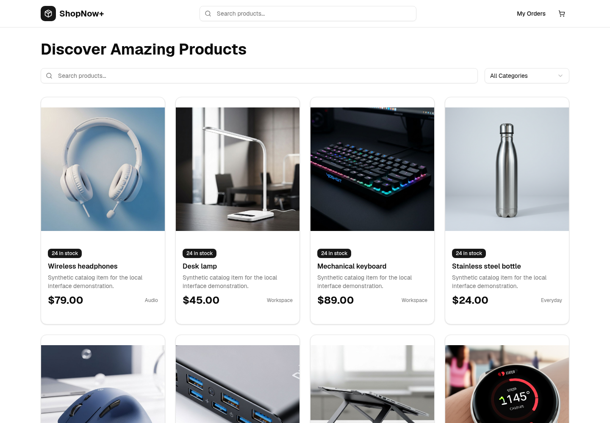
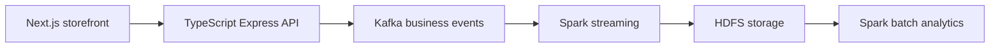

# ShopNow+

**Une boutique reliée à un pipeline de données événementiel.**

[English](../README.md) · [Portfolio](https://www.webbyphil.net/)

Un système e-commerce académique reliant une boutique, une API métier, le streaming d’événements, le stockage distribué et l’analytique. Il montre comment les actions produit peuvent alimenter un pipeline de données.

**React · Next.js · TypeScript · Express · Kafka · Spark · HDFS · Docker**

*Interface réelle exécutée localement avec des données fictives. La capture ne démontre pas un usage de production.*

## Fonctionnalités

- Catalogue, panier et commandes dans une interface React/Next.js.
- API TypeScript pour les opérations produit et commerce.
- Événements métier Kafka, traitements Spark et stockage HDFS.
- Services conteneurisés et vérifications d’intégration existantes en shell.

## Architecture

## Ma contribution

J’ai réalisé ce projet académique pour relier des parcours applicatifs full-stack à un pipeline distribué. Le sujet technique est le devenir d’une action utilisateur : l’événement émis, son traitement et l’endroit où inspecter les données produites. Il s’agit d’une démonstration technique, pas d’une boutique commerciale.

## Installation et consultation

Ce dépôt contient uniquement la présentation. Le projet privé utilise Next.js, Express et Docker Compose pour Kafka, HDFS et Spark. Son installation d’origine recommande au moins 8 Go de RAM. La capture utilise un catalogue fictif, sans commandes réelles ni métriques de pipeline.

## État actuel et limites

Démonstration académique : aucun paiement réel, usage client ou débit de production n’est revendiqué. Le frontend prévoit un repli sur des données fictives lorsque l’API est indisponible. Le pipeline complet nécessite des ressources Docker locales importantes. Le code reste privé dans cette publication.

Les crédits et références d’origine sont conservés dans le [README principal](../README.md#credits).
